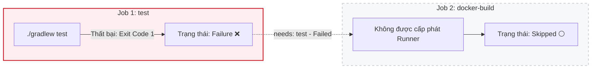

# Báo cáo Kỹ thuật: Nối Job tự động Build & Push Docker Image sau khi Test Gradle xanh

## 1. Mục tiêu bài thực hành
- Thiết kế kiến trúc CI/CD pipeline chuẩn hóa theo mô hình đa tầng (Multi-Job Pipeline), tách biệt rõ ràng giữa giai đoạn Kiểm thử & Đóng gói nhị phân (Testing & Packaging) với giai đoạn Đóng gói Container & Phát hành (Containerization & Release).
- Sử dụng từ khóa điều phối `needs: test` để thiết lập mối quan hệ phụ thuộc tuần tự giữa các Job độc lập theo mô hình đồ thị có hướng không chu trình (DAG).
- Đảm bảo nguyên tắc chất lượng phần mềm (Quality Gate): Container Image chỉ được phép biên dịch và đẩy lên GitHub Container Registry (`ghcr.io`) khi và chỉ khi toàn bộ các kiểm thử đơn vị đều đạt trạng thái thành công (Green Status).
- Khảo sát và phân tích cơ chế ngắt mạch tự động (Circuit Breaking) khi một bài kiểm thử bị lỗi, khiến Job phụ thuộc chuyển ngay sang trạng thái `Skipped` (Bị bỏ qua).

---

## 2. Kịch bản Kỹ thuật

### 2.1. Kịch bản GitHub Actions Workflow (`.github/workflows/ci.yml`)
```yaml
name: Java Spring Boot CI/CD (Gradle & Docker)

on:
  push:
    branches: [ "main" ]

jobs:
  test:
    name: Run Unit Tests & Build JAR
    runs-on: ubuntu-latest

    steps:
      - name: Checkout mã nguồn
        uses: actions/checkout@v5

      - name: Thiết lập môi trường Java JDK 17
        uses: actions/setup-java@v5
        with:
          java-version: '17'
          distribution: 'temurin'
          cache: 'gradle'

      - name: Cấp quyền cho Gradle Wrapper
        run: chmod +x gradlew

      - name: Thực thi JUnit Test với Gradle
        run: ./gradlew test

      - name: Đóng gói tệp JAR với Gradle
        run: ./gradlew bootJar

      - name: Lưu trữ thành phẩm JAR Artifact
        uses: actions/upload-artifact@v4
        with:
          name: app-jar
          path: build/libs/*.jar

  docker-build:
    name: Build and Push Docker Image
    needs: test
    runs-on: ubuntu-latest

    steps:
      - name: Checkout mã nguồn
        uses: actions/checkout@v5

      - name: Tải về thành phẩm JAR Artifact
        uses: actions/download-artifact@v4
        with:
          name: app-jar
          path: build/libs

      - name: Chuyển đổi tên Image sang chữ thường
        id: image_tag
        run: |
          REPO_LOWER=$(echo "${{ github.repository }}" | tr '[:upper:]' '[:lower:]')
          echo "tag=ghcr.io/${REPO_LOWER}:latest" >> "$GITHUB_OUTPUT"

      - name: Đăng nhập vào GitHub Container Registry
        uses: docker/login-action@v3
        with:
          registry: ghcr.io
          username: ${{ github.actor }}
          password: ${{ secrets.REGISTRY_TOKEN }}

      - name: Đóng gói và đẩy Docker Image lên GHCR
        uses: docker/build-push-action@v5
        with:
          context: .
          push: true
          tags: ${{ steps.image_tag.outputs.tag }}
```

### 2.2. Kịch bản đóng gói Container (`Dockerfile`)
```dockerfile
# Sử dụng image Eclipse Temurin OpenJDK 17 gọn nhẹ trên Alpine Linux
FROM eclipse-temurin:17-jre-alpine

# Thiết lập thư mục làm việc bên trong container
WORKDIR /app

# Sao chép tệp Fat JAR đã được đóng gói từ bước Gradle bootJar
COPY build/libs/*.jar app.jar

# Mở cổng 8080 cho ứng dụng Spring Boot
EXPOSE 8080

# Thiết lập điểm khởi chạy ứng dụng
ENTRYPOINT ["java", "-jar", "app.jar"]
```

---

## 3. Phân tích Cơ chế Kiến trúc DAG và Từ khóa `needs`

### 3.1. Mô hình Đồ thị có hướng không chu trình (DAG)
Mặc định trong GitHub Actions, nếu không khai báo `needs`, tất cả các Job trong tệp workflow sẽ khởi chạy **song song** (Parallel Execution) để tối đa hóa tốc độ. Tuy nhiên, việc đóng gói Docker Image đòi hỏi phải có tệp `.jar` hợp lệ và code đã được kiểm thử an toàn. 

Bằng cách chỉ định `needs: test`:
- GitHub Actions Runtime sẽ xây dựng một đồ thị phụ thuộc (Dependency Graph) với cạnh có hướng: `test` $\rightarrow$ `docker-build`.
- Job `docker-build` sẽ bị đưa vào trạng thái hàng đợi chờ (`Queued` / `Waiting`) cho đến khi Job `test` phát tín hiệu hoàn thành thành công (`success`).

### 3.2. Sơ đồ Thực thi Tuần tự khi Test Thành công (Happy Path)

```mermaid
graph LR
    subgraph Job1["Job 1: test (Run Unit Tests & Build JAR)"]
        A1[Checkout Code] --> A2[Setup JDK 17 & Cache]
        A2 --> A3[chmod +x gradlew]
        A3 --> A4[./gradlew test]
        A4 --> A5[./gradlew bootJar]
        A5 --> A6[Upload Artifact: app-jar]
    end

    subgraph Job2["Job 2: docker-build (Build & Push Docker Image)"]
        B1[Download Artifact: app-jar] --> B2[Format Lowercase Tag]
        B2 --> B3[Login GHCR]
        B3 --> B4[docker/build-push-action]
        B4 --> B5[Image Pushed to ghcr.io:latest]
    end

    A6 ==>|needs: test - Success| B1

    style Job1 fill:#e6ffed,stroke:#2ea44f,stroke-width:2px
    style Job2 fill:#e6ffed,stroke:#2ea44f,stroke-width:2px
```


### 3.3. Sơ đồ Tự động Ngắt mạch khi Test Thất bại (Failure & Skipped Path)
Nếu nhà phát triển vô tình đẩy code gây lỗi kiểm thử logic:



---

## 4. Kiểm chứng Thực nghiệm

### 4.1. Thử nghiệm 1: Kiểm thử xanh và Build & Push thành công
- **Tình trạng:** Cả 2 bài kiểm thử `contextLoads()` và `testBasicCalculation()` đều pass.
- **Kết quả:** 
  - Job `test` hoàn tất sau ~25s.
  - Tệp `app-jar` được tải lên GitHub Storage.
  - Job `docker-build` nhận tín hiệu kích hoạt, tải artifact về `build/libs/`, đăng nhập `ghcr.io` và đẩy thành công container image lên GitHub Packages.
  - Trên tab Actions hiển thị biểu đồ 2 node nối nhau bằng mũi tên màu xanh.

### 4.2. Thử nghiệm 2: Cố tình làm hỏng bài kiểm thử (Failure Testing)
Để kiểm tra tính năng bảo vệ của pipeline, ta cố tình thay đổi mã kiểm thử trong `ApplicationTests.java`:
```java
@Test
void testBasicCalculation() {
    // Cố tình tạo assertion sai: 5 + 5 = 10 nhưng mong đợi là 99
    assertEquals(99, 5 + 5);
}
```
- **Kết quả quan sát trên GitHub Actions:**
  - Tại bước `./gradlew test` của Job `test`: Gradle phát hiện lỗi assertion failure và trả về mã lỗi `BUILD FAILED`.
  - Toàn bộ các bước sau của Job `test` (bootJar, upload artifact) bị hủy bỏ.
  - Job `test` đổi màu đỏ (Failure).
  - Ngay lập tức, Job `docker-build` chuyển sang trạng thái biểu tượng vòng tròn màu xám nhạt (`Skipped`).
  - Hệ thống ngăn chặn hoàn toàn việc phát hành image lỗi lên Registry.

---

## 5. Hướng dẫn kiểm tra và minh chứng trên GitHub Actions

### Các bước kiểm tra:
1. Truy cập vào kho lưu trữ: `https://github.com/ChongChi-hub/IT209_Session_11_Bai_05`.
2. Vào tab **Actions** -> Chọn workflow run mới nhất.
3. Quan sát khu vực trực quan hóa sơ đồ workflow (Workflow Graph):
   - Xuất hiện khối `Run Unit Tests & Build JAR` với mũi tên nối sang khối `Build and Push Docker Image`.
   - Cả 2 khối đều mang biểu tượng tích xanh (Success).
4. (Tùy chọn) Kiểm tra tab **Packages** trên trang hồ sơ cá nhân hoặc repository để xác nhận image đã được lưu trữ trên GitHub Container Registry.

### Ảnh chụp màn hình minh chứng:
> *(Dán ảnh chụp màn hình biểu đồ Workflow hiển thị 2 Job kết nối thành công và ảnh chụp màn hình trường hợp Job 2 bị Skipped khi test fail vào vị trí dưới đây)*

`ImgEx`
